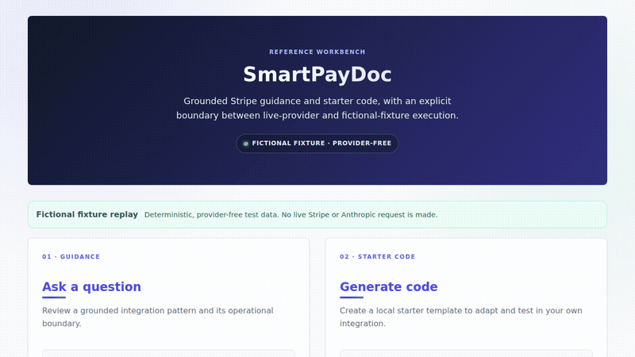

# SmartPayDoc

Stripe reference retrieval, starter-code generation, error debugging, and webhook inspection through a CLI and browser UI.

## Install and run

Python 3.11 or 3.12:

```sh
python -m venv .venv
source .venv/bin/activate
pip install -r requirements-dev.txt
pip install --no-deps .
python -m smartpaydoc --help
smartpaydoc init
smartpaydoc generate "create a payment intent" --lang python --framework flask
smartpaydoc generate "subscription checkout"
smartpaydoc debug "card_declined"
smartpaydoc webhook event.json
```

Bundled templates, known error explanations, webhook inspection, and local retrieval work without provider credentials. AI answers and custom code require both `ANTHROPIC_API_KEY` and `ANTHROPIC_MODEL` configured for your account. Model selection is explicit.

```sh
smartpaydoc ask "How do I create a payment intent?"
smartpaydoc generate "custom payment flow" --lang python --framework fastapi
uvicorn web_app:app --host 127.0.0.1 --port 8000
```

Open `http://127.0.0.1:8000`. The compatibility entrypoint `web.main:app` uses the same tested application. CLI failures exit nonzero. Starter code is reference material to adapt and test; generation does not establish production readiness.

### Provider-free fictional fixture

The browser workflow has one explicit deterministic demo mode:

```sh
SMARTPAYDOC_DEMO_MODE=fictional-fixture uvicorn web_app:app --host 127.0.0.1 --port 8000
```

The API and UI label this mode as **FICTIONAL FIXTURE · PROVIDER-FREE**. It uses a bundled immutable answer for browser testing and demonstrations; it does not contact Anthropic or Stripe, process payments, or measure provider quality. With the variable absent, the application remains in live mode and AI-backed endpoints fail closed when credentials are missing.

## API contracts

- `GET /health`: readiness, reference count, provider configuration status.
- `POST /api/ask`: question and language; plain-text grounded AI answer.
- `POST /api/generate`: task (or browser form prompt), language, framework; JSON `{ "code": "..." }`.
- `POST /api/debug`: error_log and optional context.
- `POST /api/webhook`: payload, optional verify and signature.

Both the existing browser's form payloads and JSON clients work. Missing AI credentials return 503; provider failures return 502. Local development needs no public deployment. Public deployment requires authentication and request/spending controls.

## Retrieval and webhook behavior

Retrieval uses deterministic local hashed lexical features over bundled reference excerpts. The retrieved text and source URLs are included in the model request. `init` loads bundled excerpts; it does not crawl or refresh live documentation. Cached JSON documents are re-indexed on load. Legacy random-vector pickle caches are never unpickled. This is local lexical retrieval, not a hosted semantic embedding service.

Webhook inspection is explicitly unverified unless verification is requested. Verification uses Stripe's SDK with the raw payload, signature header, endpoint secret, and a 300-second timestamp tolerance. Missing or invalid signatures fail:

```sh
STRIPE_WEBHOOK_SECRET=your_endpoint_secret smartpaydoc webhook event.json --verify --signature 't=...,v1=...'
```

This tool analyzes payloads and generates code; it does not process payments or change Stripe accounts. Offline checks do not demonstrate live Stripe or Anthropic operation.

## Validation

```sh
python -m pytest tests -q --no-cov
```

The default suite makes no paid requests. It covers deterministic retrieval/cache reload, CLI entrypoints, browser request contracts, grounded requests using an injected provider, failure propagation, valid/tampered/stale signatures, and missing credentials. Live-provider tests require explicit `SMARTPAYDOC_RUN_LIVE_TESTS=1` plus configured credentials and are skipped by default.

Real browser validation is separate from API-contract testing. CI installs Chromium and runs `scripts/browser_smoke.py` on desktop and mobile viewports. A passing browser job is required before a UI recording is released.

## Verified demo

The checked-in GIF and MP4 replay the actual FastAPI browser workflow in the visibly labeled fictional-fixture mode. `scripts/verify_demo.py` checks the captured source identity and blobs, artifact hashes, dimensions, frame counts, and full media decoding.



[MP4 demo](docs/demo/smartpaydoc-fixture-demo.mp4) · [poster](docs/demo/smartpaydoc-fixture-demo-poster.png)
